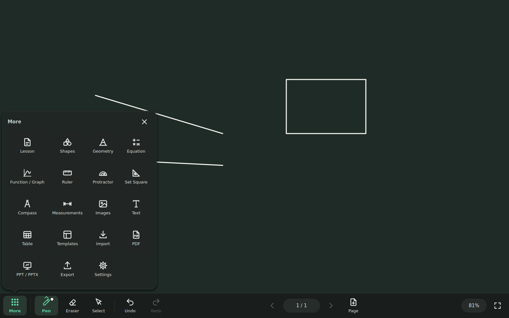

# ClassBoard for Android

ClassBoard is an open-source digital whiteboard for classroom displays, interactive panels and
tablets. This is the native **Android** edition of
[ClassBoard for Windows](https://github.com/An0nym0us-glitch/Smart-board): the same interface,
the same tools and the same `.classboard` lesson files, rebuilt with Android's own UI toolkit
(Kotlin, no Qt, no web view). It works fully offline.

The board fills the screen. The most-used commands sit in a ribbon along the bottom, and the
rest open as popovers attached to the button that opened them, so you stay on the board.



## Features

| Area | What you get |
|---|---|
| **Ink** | Smooth pen, highlighter, dashed and dotted ink, stylus pressure. The Magic Highlighter's marks fade away after about five seconds and are never saved. Ten-point touch: every finger writes its own line, two fingers of one hand zoom and pan. Optional shape recognition. |
| **Eraser** | Stroke, object and area modes; the area eraser rubs out exactly what is under it, even one side of a triangle. Wipe with three fingers held together or the flat of your hand at any time (one undo step). Stylus eraser end supported. |
| **Select** | Tap, rectangle or lasso selection, multi-select. Move, resize, rotate (15° snapping) and edit points. Floating bar: edit, exact values, ✨ magic, colour, front/back, duplicate, copy, delete. |
| **Shapes** | Line, arrow, double arrow, rectangle, rounded rectangle, circle, ellipse, triangle, right triangle, diamond, parallelogram, hexagon, regular polygon and free polygon. Fill none, tint or solid. |
| **Instruments** | Ruler (draw along its edges, adjustable length), protractor with measuring arms and angle stamp, 45° and 30/60° set square, compass that draws arcs and circles. Two fingers move and rotate them. |
| **Geometry** | Live distance, angle, slope and area measurements; points, segments, lines, rays and vectors with snapping to points and the grid. Exact values for lengths, directions, angles, rise/run/slope and shape sizes, and drawing scales such as 10 cm = 1 km. |
| **Equations** | LaTeX-style input with a symbol palette and live preview: fractions, roots, powers, integrals, sums, limits, vectors, matrices, cases, Greek letters. The ✨ Magic Equation Maker turns selected handwriting into an equation (offline). |
| **Calculator** | Big touch keys, trigonometry in DEG/RAD, logarithms, factorial, percent, Ans, recent calculations and *Put on board*. |
| **Graphs** | Several functions with automatic parameter sliders, pan and pinch zoom, points that snap onto curves, vectors and value tables. |
| **Pages** | New, duplicate, clear and delete; navigator with thumbnails, drag to reorder, rename. Page sizes 16:9, 4:3, A4, A3 or custom; background colours; templates (blackboard, whiteboard, grid, dots, ruled, graph paper, music staves, coordinate plane, or your own picture). |
| **Files** | `.classboard` lessons are byte-compatible with ClassBoard for Windows. Open and save anywhere through Android's file picker (device, SD card, Google Drive …), autosave and crash recovery, open lessons from a file manager. |
| **Import / export** | Import images, pages of other lessons and PDFs (every page keeps its size, rendered offline with Android's PDF renderer). Export vector PDF, PowerPoint `.pptx` and PNG of complete pages. |

There is one undo/redo history for every tool, and undo jumps to the page it changes.

**PowerPoint import:** the Windows version converts slides with an installed office suite.
Android has none, so save the presentation as PDF (PowerPoint, Google Slides or WPS: *Save as
PDF*) and import the PDF — every slide becomes a page.

## Install

1. On the Android device, open
   **https://github.com/An0nym0us-glitch/Smart-board-for-android/releases/download/latest/ClassBoard.apk**
   (or the [Releases page](https://github.com/An0nym0us-glitch/Smart-board-for-android/releases/tag/latest)).
2. Open the downloaded `ClassBoard.apk` and allow **Install unknown apps** for your browser or
   file manager when Android asks, then tap **Install**.
3. ClassBoard appears in the app drawer with its own icon.

Files under a GitHub Actions run are wrapped in a `.zip`; if you download from there, unzip it
first and open the `.apk` inside. Android 7.0 (API 24) or newer; tablets, interactive flat
panels and phones are supported.

## Building

Requirements: JDK 17 and the Android SDK (API 35). Then:

```bash
./gradlew assembleDebug        # app/build/outputs/apk/debug/app-debug.apk
./gradlew testDebugUnitTest    # unit tests
```

Or open the folder in Android Studio and press *Run*. The release build is signed with the
debug key so it installs directly; use your own signing configuration before publishing to a
store.

## Project layout

```text
app/src/main/java/com/classboard/app/
  core/       geometry helpers, JSON helpers
  doc/        document model, pages, objects, undo/redo, templates, images
  math/       expressions, calculator, equation typesetter, graphs, tables, coordinates
  geometry/   instruments, measurements, constructions, exact values
  tools/      pen, eraser, select, shape, text, measure, construct and graph tools
  input/      touch / stylus / mouse handling, ten-point touch and palm gestures
  render/     page renderer
  ai/         shape recogniser, handwriting-to-equation recogniser
  storage/    .classboard container and serializer, autosave, PDF import, settings
  export/     PDF, PNG and PPTX exporters
  ui/         theme, icons, ribbon, popovers, widgets, panels, board view, editors
```

## License

MIT. See [LICENSE](LICENSE).
